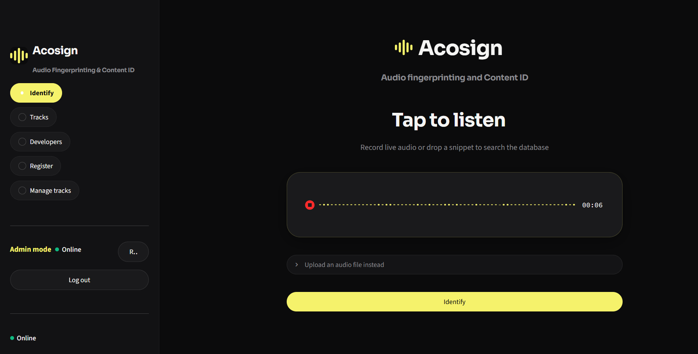
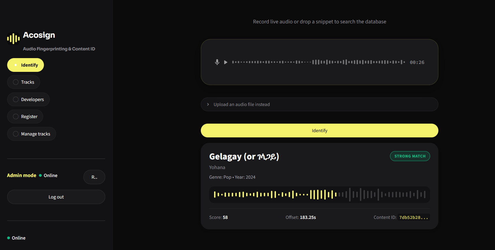
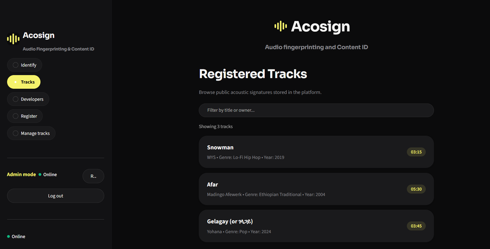
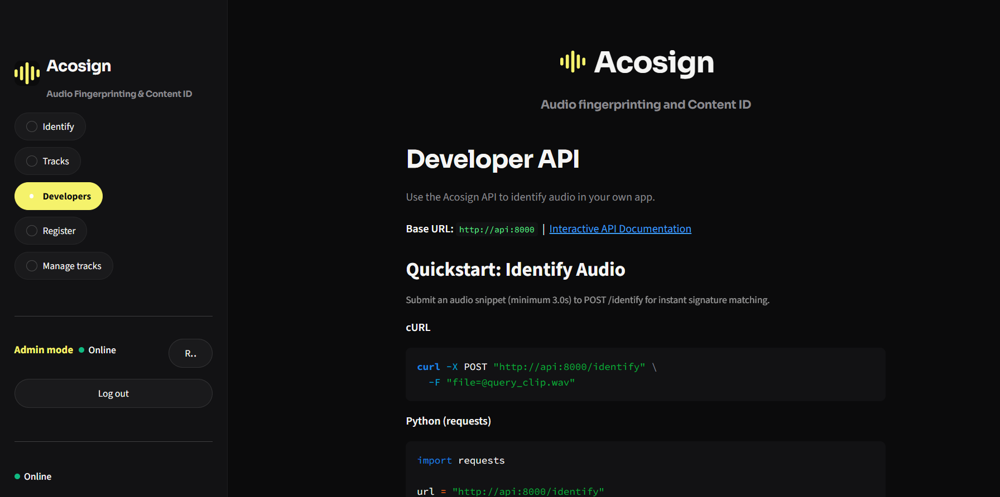
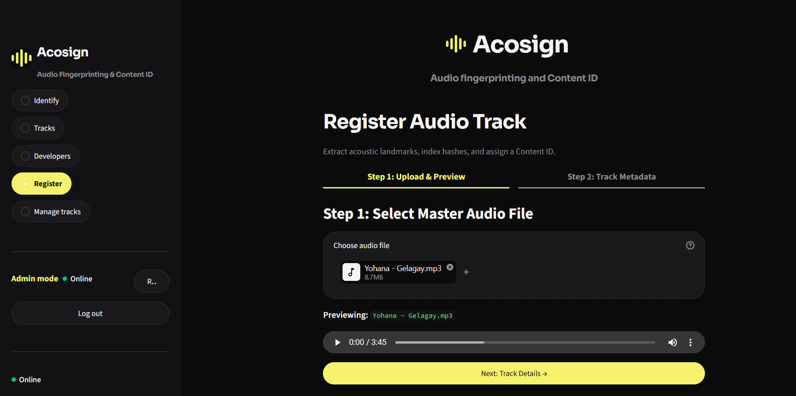
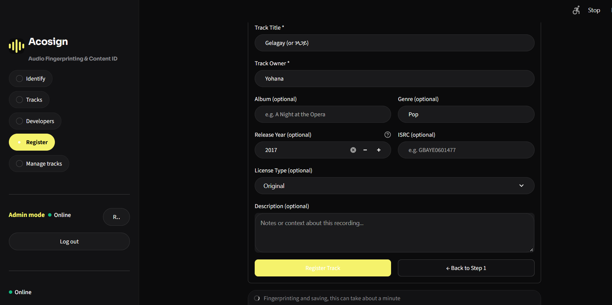
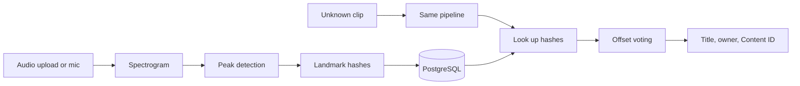

<p align="center">
  
</p>

<h1 align="center">Acosign</h1>

<p align="center">
  <b>Audio digital signature and Content ID platform</b><br>
  <i>An API that turns audio into a unique fingerprint, so copyright owners can be found from a short clip.</i>
</p>
## Developer

| Name | ID | GitHub | Role |
|------|----|--------|------|
| **Abel Fekede** | CTC-5298-26 | [@afgjr](https://github.com/afgjr) | Full stack developer |

## What it does

Acosign takes an audio track, creates an acoustic fingerprint, stores it with a unique Content ID and the owner's details, and then identifies unknown clips against everything registered. Play 5 seconds of a song near the microphone and it returns the title and owner.

## Demo video

[](https://drive.google.com/file/d/1XzTsCR529qfJbZZ41-dHr9OdaNkniElT/view)

A 3-minute walkthrough: identifying a song from the microphone, uploading a file, browsing tracks, the developer API, and registering a track as admin.

## Screenshots

**Identify**

| Listening | Result |
|---|---|
|  |  |

**Catalogue and developers**

| Tracks | Developers |
|---|---|
|  |  |

**Register (admin)**

| Step 1: choose the file | Step 2: add the details |
|---|---|
|  |  |

## How it works



1. **Spectrogram:** the audio becomes a time-frequency map.
2. **Peaks:** only the loudest points are kept, because they survive noise and compression.
3. **Hashes:** each peak is paired with its neighbours and packed into a 34-bit integer.
4. **Matching:** hashes from the clip are looked up in the database. For each track, the system counts how many hashes agree on one time offset. The true track shows a sharp spike, so coincidental matches are rejected.

Details are in [docs/architecture.md](docs/architecture.md) implemented with Librosa, NumPy and SciPy.


## Quick start (Docker)

```bash
git clone https://github.com/afgjr/Acosign.git
cd Acosign
cp .env.example .env        # Windows: copy .env.example .env
# edit .env and set ADMIN_API_KEY to a long random value
docker compose up --build
```

- Web app: http://localhost:8501
- API docs: http://localhost:8000/docs

The first build downloads several hundred MB and can take a while on a slow connection. Later builds reuse the cache. Change the database passwords in `.env` before any real deployment.

Generate a key with: `python -c "import secrets; print(secrets.token_urlsafe(32))"`

## Run without Docker (alternative)

```bash
python -m venv venv
venv\Scripts\activate                      # Linux/macOS: source venv/bin/activate
pip install -r requirements.txt -r requirements-ui.txt
docker compose up -d db                    # PostgreSQL only, on localhost:5433
uvicorn app.main:app --port 8000
streamlit run ui/app.py                    # in a second terminal, venv active
```

## API

| Method | Path | Access | Purpose |
|---|---|---|---|
| POST | `/identify` | Public | Identify a clip |
| GET | `/tracks`, `/tracks/{content_id}` | Public | List or read tracks |
| GET | `/health` | Public | API and database status |
| POST | `/register` | Admin | Register a track |
| DELETE | `/tracks/{content_id}` | Admin | Delete a track |
| GET | `/admin/verify` | Admin | Check an admin key |

```bash
curl -X POST http://localhost:8000/identify -F "file=@clip.wav"
```

Admin endpoints need the header `X-API-Key: <your key>`. The full reference is in [docs/api.md](docs/api.md). `match_strength` (strong or weak) is derived from the vote score.

## Supported audio

MP3 and WAV are the main formats. Other formats such as M4A are decoded with ffmpeg, which is included in the Docker image. Clips longer than 20 seconds are trimmed to their middle window for identification.

## Testing and results

```bash
python -m pytest -q
```

The engine was evaluated with 3 registered tracks (about 300,000 hashes) and 270 queries:

| Condition (5 s clips) | Accuracy |
|---|---|
| Clean | 86.7% |
| Noise at 10 dB | 93.3% |
| Phone-speaker low-pass | 93.3% |
| 10 s clips | 93 to 100% |

**False positives: 0 of 270.** A live speaker-and-microphone test identified all 3 demo tracks with a strong match. Full tables and methods are in [docs/testing.md](docs/testing.md).

## Known limits

- Clips of 3 seconds or less are unreliable. Use 5 seconds or more.
- Heavy noise (5 dB) lowers accuracy on short clips.
- Registration takes about a minute for a 3-minute track.
- Admin access uses one shared secret key.
- Evaluated on a small catalogue (3 tracks).

## Roadmap

- Per-user accounts with hashed passwords and expiring tokens
- Per-developer API keys with rate limits and usage tracking
- HTTPS deployment and a production frontend
- Larger catalogue and a faster, batched registration pipeline


## Tech stack

FastAPI, Librosa, NumPy, SciPy, PostgreSQL (SQLAlchemy), Streamlit, Docker Compose.
